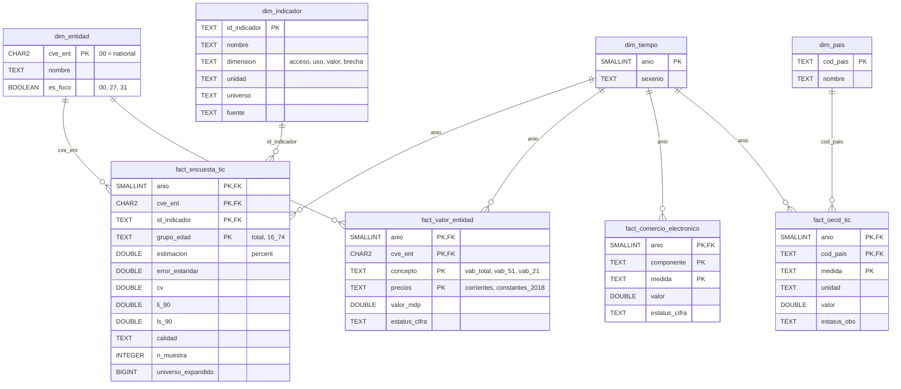

# Warehouse model (gold layer)

Star schema of `economia_digital_dw.gold`, loaded by `src/silver_to_gold.py` (`sql/gold/gold.sql`
plus the design-based survey estimates computed in Python). DDL in `sql/init.sql`. Static image:
[`warehouse_model.png`](warehouse_model.png) (source: [`warehouse_model.dot`](warehouse_model.dot)).
Column details: [`data_dictionary_gold.md`](data_dictionary_gold.md).

## Grains

| Table / view | Type | Grain |
| --- | --- | --- |
| `dim_entidad` | dimension | state (32) + national `'00'` |
| `dim_tiempo` | dimension | year, 2003–2025 (union of all sources) |
| `dim_indicador` | dimension | indicator (19 survey + 4 value) |
| `dim_pais` | dimension | OECD country or aggregate (OECD, EU27, EU28) |
| `fact_encuesta_tic` | fact | year × state × indicator × age group (ENDUTIH 2020–2024) |
| `fact_valor_entidad` | fact | year × state × concept × prices (PIB estatal 2003–2023) |
| `fact_comercio_electronico` | fact | year × component × measure (national, 2013–2024) |
| `fact_oecd_tic` | fact | year × country × measure (2015–2025) |
| `kpi_entidad_anio` | view | year × state, survey indicators in columns + sector-51 value |
| `valor_entidad_anio` | view | year × state, sector-51 share (with and without mining), real growth |
| `comercio_electronico_anio` | view | year, national e-commerce GVA wide |
| `resultado_*` | results | see [`data_dictionary_gold.md`](data_dictionary_gold.md) |

**Why survey facts store estimates, not microdata.** Gold keeps one row per estimate with its
standard error, so every consumer (API, dashboard, figures) shows the same number with the same
uncertainty. The microdata stays in silver (`endutih_hogar`, `endutih_persona`), from which
`validaciones/gold.sql` recomputes the point estimates.
